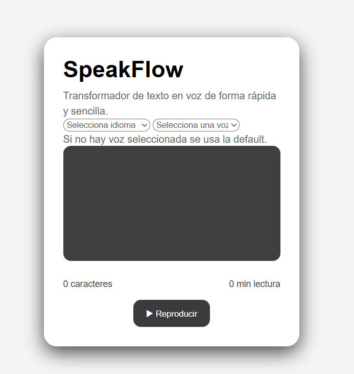
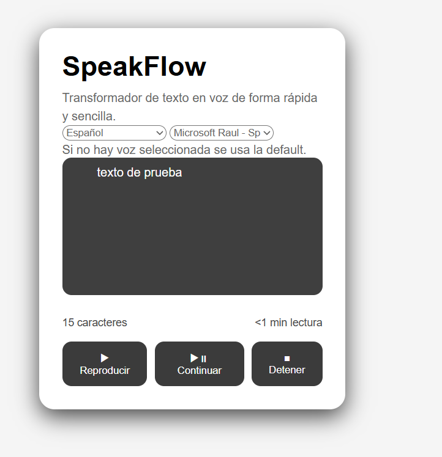

# SpeakFlow

Desarrollé SpeakFlow como un proyecto personal para convertir texto en voz directamente desde el navegador, utilizando HTML, CSS, JavaScript y Web Speech API.

La aplicación permite seleccionar diferentes voces e idiomas, además de controlar la reproducción del texto.

## Características

- Conversión de texto a voz.
- **Personalización de voz:**
  1. Selección entre múltiples voces disponibles.
  2. Selección de idioma.
- **Controles de reproducción:**
  1. Pausar.
  2. Reanudar.
  3. Detener.
- Contador de caracteres.
- Estimación del tiempo de lectura.

## Vista previa

Interfaz principal:

Prueba de funcionamiento:

## Tecnologías utilizadas

- HTML5
- CSS3
- JavaScript
- Web Speech API

## Cómo ejecutar el proyecto

No necesitas instalar dependencias ni utilizar frameworks.

1. Clona el repositorio o descarga el proyecto.
2. Abre la carpeta descargada.
3. Ejecuta el archivo `index.html` en tu navegador.

## Compatibilidad

SpeakFlow utiliza Web Speech API, por lo que necesitas un navegador compatible con esta tecnología.

Las voces disponibles pueden variar dependiendo del navegador y del sistema operativo.

## Estado del proyecto

Primera versión estable y funcional (v1.0).

## Autor

Edwin Olivas